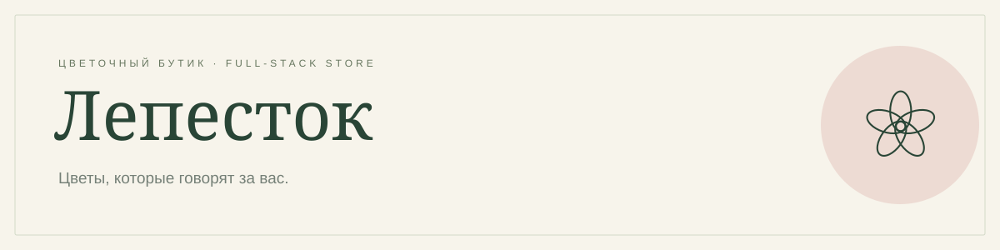
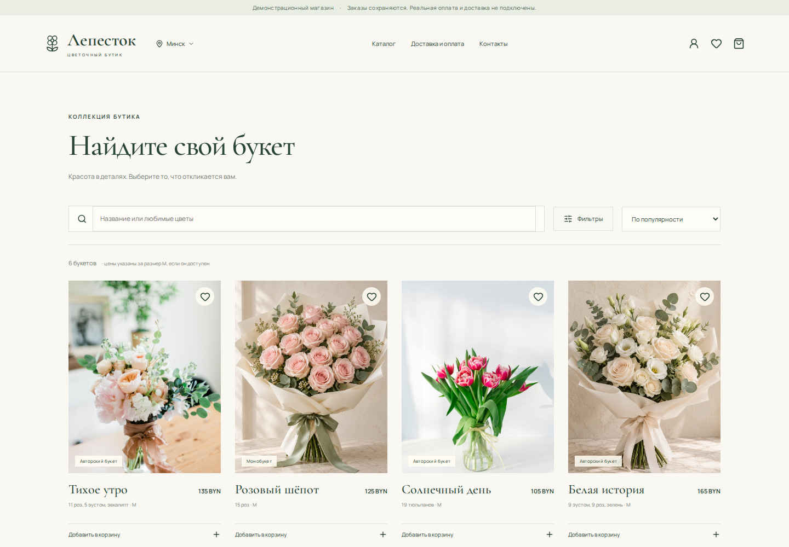
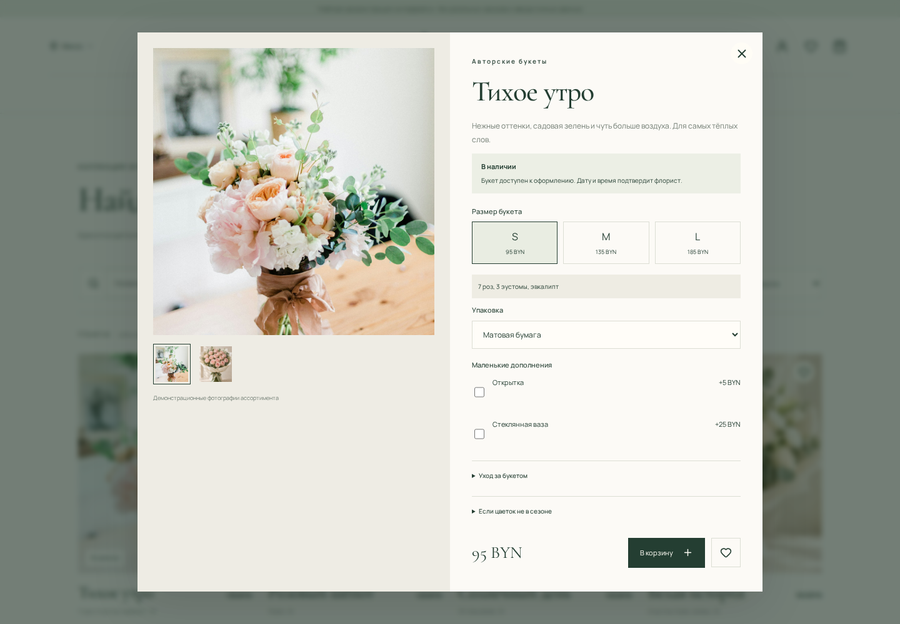
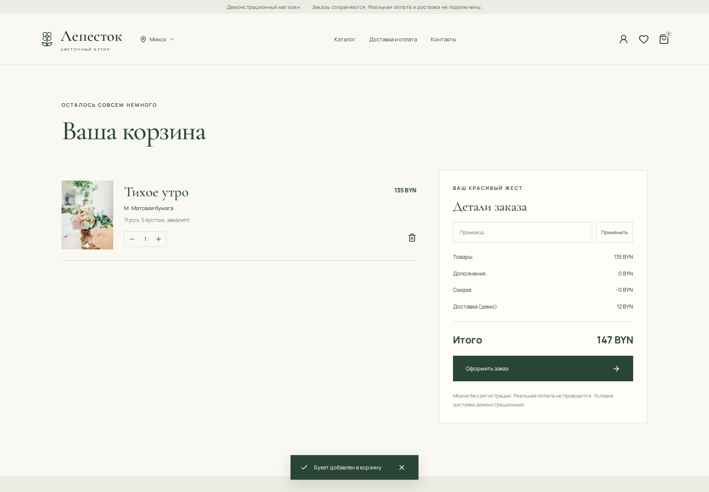
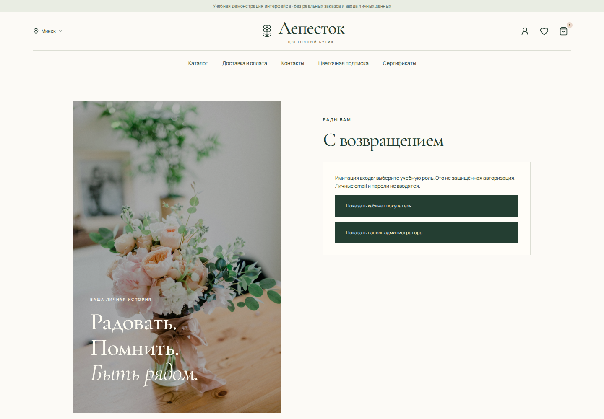
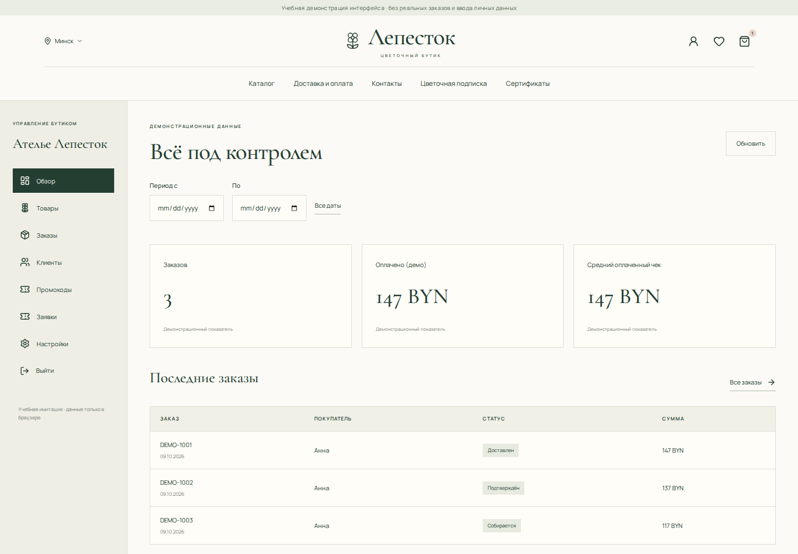
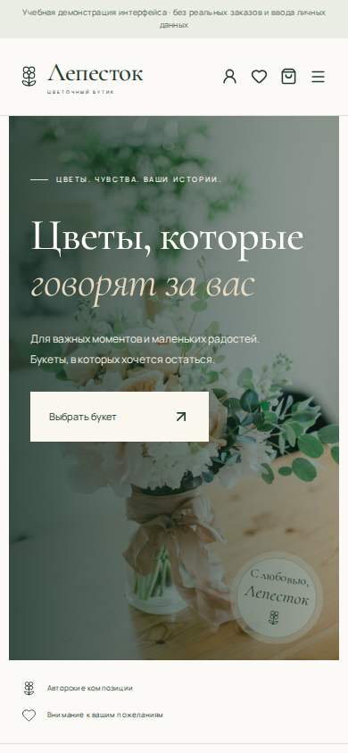

<div align="center">



**Лепесток 2.0 · цветочная витрина, личный кабинет и серверная админ-панель.**

Каталог → выбор букета → корзина → заказ → управление в админ-панели.

[](https://github.com/ECL1SSI/lepestok-flower-shop/actions/workflows/ci.yml)


[Предыдущая серверная демонстрация 1.0](https://lepestok-flower-boutique.ambergull5.chatgpt.site) · [Функции](#возможности) · [Запуск](#локальный-запуск) · [Облачная публикация](#публикация-без-компьютера)

</div>

> Демонстрационная версия. Заказы сохраняются в серверной базе данных. Реальная оплата, курьерская служба и уведомления не подключены. Условия доставки, исходные товары и заказы — демонстрационные. Доступность старого домена `chatgpt.site` зависит от защиты его хостинга.

## Что изменилось в версии 2.0

- Первый экран с крупной фотографией, тематические коллекции, быстрые категории и актуальные букеты. LETO flowers использован как структурный и визуальный референс; бренд, тексты, контакты и изображения проекта сохранены собственными.
- Статусы: «В наличии», «Под заказ», «Доступен к повтору», «Нет в наличии». Старый флаг наличия поддерживается; администратор управляет новым статусом.
- Подписка, сертификаты и индивидуальный букет сохраняются как заявки на согласование. В серверной панели появился раздел «Заявки» со статусами. Списание денег, выпуск сертификата и запуск подписки не выполняются.
- Добавлена безопасная статическая учебная сборка. В ней отключён ввод контактов, паролей и загрузка файлов; вход — явная имитация выбором роли. Для заявки или заказа используются вымышленные данные. Серверные API не вызываются.
- Миграция `0001_record_kind_index.sql` добавляет индекс и недостающие категории. Пользователи, сессии, товары и снимки заказов не удаляются.

## Две версии и публикация с телефона

| Версия | Где работает | Данные и вход |
| --- | --- | --- |
| Учебная демонстрация | GitHub Pages после включения Pages | Фиксированные примеры, имитация ролей и localStorage, без реальных продаж |
| Серверный магазин | Cloudflare Workers + D1 + R2 | Серверные роли, хеши паролей, настоящая база заказов и заявок |

### GitHub Pages

Workflow **«Учебная демонстрация — GitHub Pages»** уже подготовлен. До успешного deployment публичный адрес учебной версии не считается подтверждённым.

1. С телефона откройте репозиторий → **Settings → Pages**.
2. В разделе **Build and deployment → Source** выберите **GitHub Actions**.
3. Откройте **Actions → «Учебная демонстрация — GitHub Pages» → Run workflow → main → Run workflow**. Если кнопка не видна, включите в браузере режим «Версия для ПК».
4. Дождитесь зелёных `build` и `deploy`. Рабочая ссылка появится в environment `github-pages` в запуске workflow.

Первичное включение Pages требует административного действия владельца. Обычный `GITHUB_TOKEN` в workflow не может самостоятельно включить Pages. Учебная версия использует путь `/lepestok-flower-shop/` и hash-навигацию, поэтому обновление внутренних страниц не требует серверных маршрутов.

Локальная учебная сборка: `pnpm build:demo`, результат — `dist-demo/`. Это отдельный результат сборки: серверный магазин по-прежнему создаётся командой `pnpm build`. В Pages не включаются Worker, база и секреты.

## Скриншоты

<!-- SCREENSHOTS:START -->
<details open>
<summary>Главная</summary>


</details>

<details>
<summary>Каталог</summary>



</details>

<details>
<summary>Карточка букета</summary>



</details>

<details>
<summary>Корзина</summary>



</details>

<details>
<summary>Вход</summary>



</details>

<details>
<summary>Панель администратора</summary>



</details>

<details>
<summary>На телефоне</summary>



</details>
<!-- SCREENSHOTS:END -->

Галерея создаётся из статической учебной сборки этого репозитория. Вход и хранение данных на этих снимках имитируются в браузере. Настоящая серверная авторизация проверяется отдельно интеграционными тестами. При первом обновлении галереи предыдущие снимки будут заменены снимками версии 2.0.

## Возможности

| Покупателям | Администратору |
| --- | --- |
| Поиск по названию и составу, фильтры, сортировка | Обзор заказов, демонстрационная выручка и средний чек |
| Галерея, размеры, актуальный состав и цена | Создание и редактирование букетов и размеров |
| Упаковка, открытка, ваза и другие дополнения | Загрузка фотографий в R2, скрытие и удаление товаров |
| Избранное, корзина между посещениями | Категории, дополнения и бюджеты |
| Покупка без обязательной регистрации | Заказы, контакты, доставка и комментарии |
| Промокоды и полная сумма до подтверждения | Статусы заказа и отдельный статус оплаты |
| Адрес, дата, интервал, анонимный подарок | Промокоды с датой, суммой и лимитами |
| Профиль, адреса и история своих заказов | Клиенты, контакты и история покупок |
| Повтор заказа с проверкой цен и наличия | Настройки магазина, зон и интервалов доставки |

Дизайн: молочный фон, глубокий зелёный текст, пудровые акценты, крупные фотографии и элегантная типографика. Адаптивная вёрстка, подписи полей, управление с клавиатуры, альтернативные тексты и поддержка reduced motion.

## Демо-аккаунты

При `DEMO_MODE=true` сервер создаёт **ровно два начальных аккаунта**. Последующая регистрация покупателей может добавлять новые.

| Роль | Email | Пароль |
| --- | --- | --- |
| Покупатель | `user@flower.test` | `UserDemo!2026` |
| Администратор | `admin@flower.test` | `AdminDemo!2026` |

У покупателя есть демонстрационные заказы и избранные букеты. Промокод **WELCOME10**: 10%, заказ от 100 BYN, одно использование на зарегистрированного покупателя. Название, город и валюта по умолчанию — **Лепесток / Минск / BYN**, меняются в настройках.

## Страницы

| Адрес | Назначение |
| --- | --- |
| `/` | Главная страница |
| `/catalog` | Каталог и фильтры |
| `/favorites` | Избранные букеты |
| `/cart` | Корзина и оформление заказа |
| `/login` | Вход и регистрация |
| `/account` | Личный кабинет |
| `/admin` | Панель администратора |
| `/subscription`, `/certificate` | Заявки на подписку и сертификат |
| `/delivery`, `/contacts` | Условия и контакты |

## Архитектура и защита

- **React + TypeScript + Vinext/Vite** — интерфейс и серверные маршруты.
- **Cloudflare Workers** — серверный код и API.
- **D1 / SQLite** — пользователи, сессии, товары, заказы, промокоды и настройки.
- **R2** — загруженные фотографии.
- Пароли: **PBKDF2 SHA-256**, 100 000 итераций, отдельная соль.
- Сессии: **HttpOnly / Secure / SameSite=Lax**, в базе хранится хеш токена.
- Сервер проверяет роли, принадлежность заказов и входные данные, ограничивает попытки входа и отклоняет межсайтовые записи.
- Профиль и регистрация не принимают назначение роли `admin`.
- Сумма заказа рассчитывается на сервере по действующим ценам. Лимиты промокодов проверяются при атомарной записи заказа.
- В заказе сохраняется снимок товара, состава, цены и валюты. Удаление букета не переписывает историю.

Исходники не привязаны к авторизации или домену ChatGPT. Для отдельного запуска используются собственные Workers, D1 и R2. GitHub хранит код и запускает автоматические процессы. **GitHub Pages не может разместить серверную часть этого магазина**: [документация GitHub Pages](https://docs.github.com/en/pages/getting-started-with-github-pages/what-is-github-pages).

## Локальный запуск

Нужны **Node.js 24+** и **pnpm 11.25.0**.

```bash
pnpm install --frozen-lockfile
cp .dev.vars.example .dev.vars
pnpm db:migrate:local
pnpm dev
```

Откройте адрес, который напечатает Vite. Демо-данные появятся при первом обращении к магазину. В `wrangler.json` указан фиктивный UUID базы исключительно для локальной разработки — для публикации замените его настоящим ID.

```bash
pnpm typecheck
pnpm test
pnpm build
```

## Публикация без компьютера

Все шаги можно выполнить в браузере телефона.

1. Разместите проект в GitHub-репозитории с основной веткой `main`.
2. В своём аккаунте Cloudflare создайте базу **D1** и корзину **R2**. Сохраните ID базы и имя корзины. Это будут новые хранилища; данные старой демонстрации не переносятся автоматически.
3. Создайте Cloudflare API Token с правами для публикации Workers, управления D1 и R2 в выбранном аккаунте.
4. В GitHub откройте **Settings → Secrets and variables → Actions** и добавьте:

| Secret | Значение |
| --- | --- |
| `CLOUDFLARE_API_TOKEN` | Токен Cloudflare |
| `CLOUDFLARE_ACCOUNT_ID` | ID вашего аккаунта Cloudflare |
| `CLOUDFLARE_D1_DATABASE_ID` | UUID созданной D1-базы |
| `CLOUDFLARE_R2_BUCKET` | Имя созданной R2-корзины |

5. Откройте **Actions → «Публикация магазина — Cloudflare» → Run workflow**. Для тестирования оставьте демонстрационный режим включённым.
6. Workflow применит миграции, выполнит проверки и сборку, затем разместит приложение в вашем аккаунте. Новый адрес будет в журнале Wrangler; обычно он имеет вид `https://lepestok-flower-shop.<ваш-поддомен>.workers.dev`.

Публикация на отдельном хостинге ещё не выполнялась: ей нужны ваши Cloudflare-ресурсы и секреты. Токены не нужно присылать в чат. Отдельный хостинг позволяет управлять собственными правилами защиты, но не гарантирует доступ из каждой сети мира.

## Автоматические процессы

| Workflow | Когда запускается | Результат |
| --- | --- | --- |
| Проверки и сборка | Push в `main`, pull request | TypeScript, обе сборки и 72 проверки выполнены локально. Актуальный результат удалённых проверок смотрите в [Actions](https://github.com/ECL1SSI/lepestok-flower-shop/actions). Снимки адаптивных размеров не заменяют проверку на настоящем телефоне.

## Перед реальными продажами

- Заполнить реальные контакты, ассортимент, фотографии, адрес самовывоза и подтверждённые условия доставки.
- Отключить демонстрационный режим. Добавить `ADMIN_EMAIL` и уникальный `ADMIN_PASSWORD` от 14 символов в GitHub Secrets для первичного создания рабочего администратора. После создания удалить пароль из runtime-секретов Cloudflare и GitHub Secrets. Демо-аккаунты при `DEMO_MODE=false` отклоняются сервером.
- Подключить оплату с проверяемыми серверными webhook, возвратами и идемпотентностью.
- Подключить доставку и уведомления, подготовить условия продажи и обработку данных, проверить устройства и резервные копии.

Сейчас заказ получает статус «Не оплачен». «Оплачен (демо)» — ручная отметка для тестирования. «Передан курьеру» не вызывает внешнюю службу. Индивидуальный букет позволяет подготовить письмо флористу после настройки email, либо скопировать пожелания.

## Структура проекта

```text
app/                 страницы и API
components/          витрина, кабинет и админ-панель
lib/                 сервер, каталог и исходные демо-данные
db/, drizzle/        схема базы и миграции
worker/              точка входа Workers
public/              изображения и значок магазина
tests/               интеграционные проверки
docs/                оформление и скриншоты
tools/screenshots/   визуальная документация на демо-данных
.github/workflows/   сборка, скриншоты и публикация
```

## Изображения и источники

Четыре иллюстративные фотографии букетов созданы Imagegen и оптимизированы в WebP. Фотографии обложки и тюльпанов: [Unsplash, обложка](https://images.unsplash.com/photo-1563241527-3004b7be0ffd) и [Unsplash, тюльпаны](https://images.unsplash.com/photo-1561181286-d3fee7d55364). Реальные отзывы, награды и гарантии не добавлены.

Документация: [Vinext](https://github.com/cloudflare/vinext), [Cloudflare D1](https://developers.cloudflare.com/d1/), [Playwright screenshots](https://playwright.dev/docs/screenshots).
